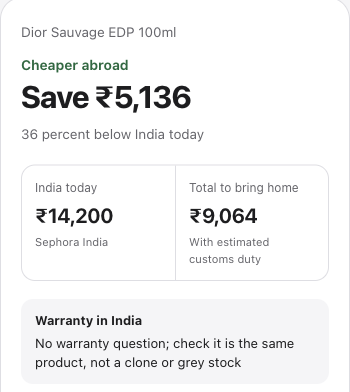

# worth-carrying



Standing in a shop abroad, wondering if that perfume, bag, watch or speaker is really cheaper than in India? Pick the country, type the product and the shelf price, and get a verdict.

Run it on your laptop, then open it on your phone on the same Wi-Fi. Lookups need a price key. SerpApi's free plan gives 250 searches a month; put `SERPAPI_API_KEY=...` in a `.env` file in the folder you run from.

```
npx github:amishah1998/worth-carrying
```

Or run one lookup from the terminal.

```
npx github:amishah1998/worth-carrying check "Dior Sauvage EDP 100ml" --price 350 --currency AED --country AE
```

The result gives India's price today across stores, India's lowest and typical price with dates, the landed cost after Indian customs duty, the warranty catch, the next big Indian sale, and the verdict. Under the form, a panel says what that country is known for and what travellers from India usually bring back. The screenshot is a real check from 1 November 2026.

## Why

Shelf prices abroad get compared against India's printed MRP, and the MRP is a fiction. Across 407 Amazon India listings tracked by [pricehistoryapp.com](https://pricehistoryapp.com/amazon-price-history), the median MRP sits 103 percent above the product's typical price over the past year. The comparison worth making is against what India sells it for, today and at its lowest, plus customs duty above the allowance, minus any warranty you lose.

## What it does

1. Turns what you typed into a search. With the optional photo reader switched on, a photo of the box works too, because the label is where "EDP" and "100ml" are printed.
2. Asks Google Shopping India for listings. One call returns the stores Google lists for India, priced in rupees.
3. Rejects wrong variants. Every word you typed must appear in the title, sizes and concentrations must agree, and decants, bundles, imports and suspiciously cheap listings are dropped, each with the reason shown. A generic query like "almonds roasted" is matched on the kind of product and compared per 100 g. With a Jev key, a yes/no question per listing adds fuzzier judgment on top.
4. Finds the history. Keepa covers Amazon.in when a key is present. Otherwise the app records every lookup from major stores, and the Node server also re-prices every product it has seen once a day, so lows and highs with dates build for Flipkart, Nykaa, Myntra and the rest over time. The card names the next big Indian sale and links to a pricehistory.app search for the product.
5. Lands the shelf price. Frankfurter converts it on the day's rate as you type, and duty at 35 percent goes on for anything above the 75,000 rupee per-person allowance. Tourist VAT refunds are not applied; see docs/rules.md.
6. Decides. Cheaper abroad, marginal, not worth carrying, or wait for the India sale, with the reason and the warranty flag.

## As an app on your phone

Host it once, open the address on your phone, and choose "Add to Home Screen". It installs with an icon, opens full screen, and keeps its shell cached for weak roaming data. With the photo reader on, the camera button opens the phone camera directly.

The page remembers the last country and currency on your device. Enter the product and shelf price, then tap **Compare prices**. The result shows the saving first, with the customs calculation, matching stores and price history in expandable sections. You can cancel a check and share a comparison.

The free way to host it is a Cloudflare Worker for the lookups and GitHub Pages for the page. [docs/deploy.md](docs/deploy.md) covers that setup, the custom domain, and the Node, Docker and Fly.io options.

## Keys

No model key is needed; matching runs on the word rules in step 3 above. The two model-backed extras, Jev for fuzzier matching and the photo reader, stay off unless the person running the server adds a key, and the page hides the camera button when the photo reader is off.

Put keys in a `.env` file in the folder you run from, or export them.

| Key | What it unlocks | Free? |
|---|---|---|
| `SERPAPI_API_KEY` | Google Shopping India through [SerpApi](https://serpapi.com/) | 250 searches a month |
| `SERPER_API_KEY` | The same through [Serper](https://serper.dev/), used first when both keys are set | 2,500 queries on signup, then about a dollar per 1,000 |
| neither | A Chrome you already run with `--remote-debugging-port=9222` reads the Google Shopping page. Development only | Free |
| `TYPESAFE_API_KEY` | Optional. Jev judges "same product" on titles the word rules cannot read, such as Hindi listings | Pay per use, cents per hundred lookups |
| `KEEPA_API_KEY` | Optional. Amazon.in price history on the first lookup | From EUR 49 a month |
| `ANTHROPIC_API_KEY` | Optional. Photo input; the camera button appears only when set. The upload, the request and the reply parsing are tested against a stand-in endpoint; accuracy on real shelf photos is not yet measured | Pay per use, about a cent per photo |

`PORT` (default 8787), `DAILY_CAP` (default 300 lookups a day, for a hosted copy), `PRICE_PROVIDER` (`serper`, `serpapi`, `chrome`), `RECORDER_DB` (default `data/observations.sqlite`), `RECHECK_HOURS` (default 24, the daily re-pricing of everything looked up; 0 turns it off; never runs on the Chrome provider), `SALES_REFRESH_DAYS` (default 7, the weekly web search for this year's Amazon and Flipkart sale dates, needs the Serper key; a date is shown only when two different sites agree, with both links).

## What leaves your machine

The product name you type goes to the price search. With the optional keys set, a photo goes to Anthropic and listing titles go to Jev. Nothing else leaves. The recorder database stays with whoever runs the backend: a file on their machine, or their own Cloudflare D1 database.

## The rules, and where they come from

Every number has a source in [docs/rules.md](docs/rules.md). In short, the allowance is 75,000 rupees duty-free per person and not pooled, duty is 35 percent on the excess, Samsung and JBL lose their India warranty when bought abroad, Apple may refuse cross-border service, and luggage brands keep a global warranty.

## Limits

The full list is in [LIMITS.md](LIMITS.md). In short, matching reads words, history starts empty, Google decides which stores appear, and duty is approximate. Phones work too, but Smartprix already does phones well; this is built for perfume, luggage, watches and speakers, which the Indian comparison sites do not cover.

## Tests and contributing

```
npm test
```

Country guides and matching fixes are the two changes most welcome; [CONTRIBUTING.md](CONTRIBUTING.md) says how, and every guide item needs the page that supports it.

## Prior art

Smartprix, MySmartPrice and 91mobiles compare Indian prices for gadgets. pricehistoryapp.com and BuyHatke show Indian price history one pasted link at a time. Keepa tracks Amazon. MobilePriceCheck compares phone prices Dubai versus India from estimates. None of them takes a name or a photo from a shop abroad and answers with the landed comparison.

MIT licence.
